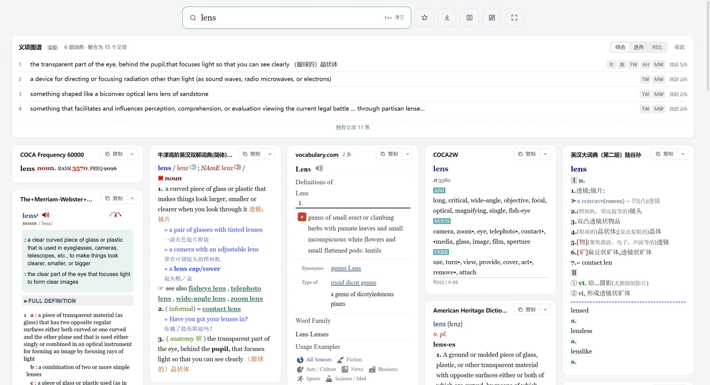
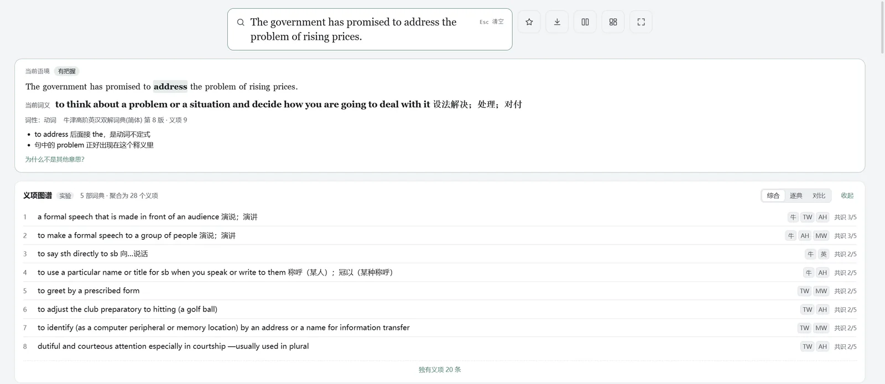
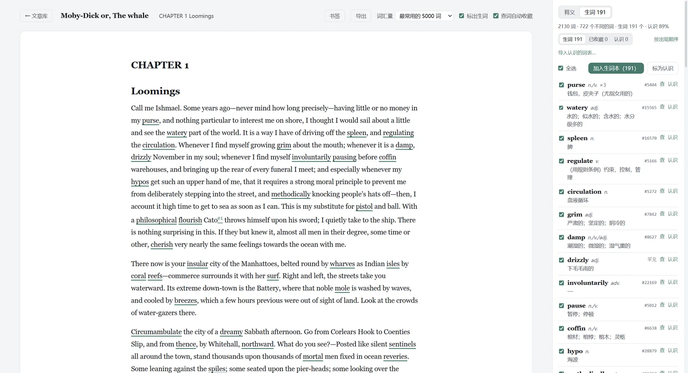

# 词镜 Lens

本地优先、键盘优先的 Windows 查词软件：十几部 MDict / StarDict 词典一起查，在任何程序里划词取句，查过的词带着原句进生词本；读英文原著时替你标好生词，还能把整本书做成预习包和 AI 精读本。

*A local-first, keyboard-first dictionary app for Windows. Look up words across your own MDict / StarDict dictionaries, capture words with their sentences from any app, read English books with new words marked, and send them to Anki.*

**官网**：<https://jacknnnbauer.github.io/lens/> · **下载**：[最新版本](https://github.com/jacknnnbauer/lens/releases/latest) · **样例**：[《白鲸》精读本 PDF](docs/samples/moby-dick-digest.pdf)

> Lens 不附带任何词典。词典内容的版权归各词典所有，请使用你自己合法获得的词典文件。下面截图里的词典内容同样归各词典所有。



## 它解决什么问题

| 读英文时的麻烦 | Lens 的做法 |
|---|---|
| 查一个词要复制、切窗口、粘贴，查完再切回来 | 任何程序里选中单词，按快捷键或连按两次 Ctrl+C，查词小窗就在旁边弹出 |
| 一本词典不够，几本来回翻 | 十几部词典同时查，卡片墙一屏看完；义项图谱把各词典的义项对齐 |
| 十几个义项，不知道句子里是哪一个 | 「当前语境」根据整句离线判断词义，列出依据和把握程度 |
| 查完就忘，也想不起在哪儿见过 | 每个生词都带着原句和出处，语境卡复习、导出 Anki |
| 原著生词太多，读不下去 | 打开 epub，按你的词汇量标出生词；读之前先做一本全书预习包 |

## 功能

**查词**

- 支持 MDict（`.mdx` / `.mdd`，含加密索引、@@@LINK 跳转）、StarDict（`.ifo`、`.dict.dz`、`.syn`）和 Lens JSON 词典。FST 索引加内存映射，十几部大词典也是即时出结果。
- 词典原样的排版、字体、发音照常显示；带脚本的词典在沙盒里运行。卡片墙按内容长短铺满窗口，拖卡片标题可以换顺序。
- **义项图谱**：把几部词典的义项按意思归组，标出哪些是共识、哪些只有一部收录。
- **当前语境**：划词或粘贴整句后点词，离线判断这个词在句中的词性和义项，说明依据。不调用 AI。
- **词汇网络**：派生词、同根词、易混词、近义词，放射图或表格。
- 屈折形式自动还原（went → go）、拼写纠错、整句点词、中文句子分词；场景配置组（Ctrl+1～9 切换）；可选在线词典。
- **中文反查与正文搜索**：输入「放弃」，列出 abandon、yield、surrender、relinquish、waive……；在所有词条的释义和例句里搜一段话。
- 右侧栏：COCA 词频、语体分布与搭配，内置 WordNet 3.1，真实例句，可选 AI 双语例句（Claude / DeepSeek）。
- 复制为 Markdown / HTML / 纯文本；单词导出 PDF / HTML；批量导出上千个词，可断点续传。



**划词与查词小窗**

- 在任何程序里选中单词，按全局快捷键或连按两次 Ctrl+C，弹出查词小窗；用 UI Automation 自动抓取所在的整句和来源（程序、窗口、网址），读不到时回退到剪贴板。
- 小窗可钉住、可扩展前后句；查过的词可以自动收进生词本，按原形合并、追加新语境；词典里查不到的词组也能收藏。

**阅读**

- 打开 epub 电子书、Markdown、txt，或直接粘贴文章；三栏：导航、正文、查词。
- 按你的词汇量把生词标在正文上，「生词」页列出全章生词、中文释义和词频排名；可导入自己认识的词表，标得更准。
- 点词就在右栏查，查过的词带着原句自动收藏；书签（Ctrl+D）、自动记住阅读位置；所见即所得编辑；导出带生词表的 PDF（书页、旁注、卡片三种版式）。



**全书预习包与精读本**

- **预习包**：读一本书之前，把整本书的生词连同书中原句做成 PDF。可以按词汇量门槛和数量上限挑词，按章节或字母排；附阅读路线表，列出每章的篇幅、用时和生词密度。
- **精读本**（可选，用你自己的 DeepSeek / Claude API Key）：AI 通读全书，写出能代替原书的分析：
  - 一句话主旨、梗概、三分钟讲解稿；
  - 每章的阅读建议：标出值得读原文、可略读、可跳过，不标的正常读；全书节奏图画出各章的紧张程度；
  - AI 按书的类型从九种图里挑几种画出来（人物关系、伏笔、地理路线、全书节奏……）；
  - 人物卡、逐章复述、名场面原文与译文、对话准备、三十道自测题。
- 引用的原文都在原书里逐字核对过；公版书给整段原文，仍有版权的书只引短段。生成前先显示估计花费，每一步存档，可以中断后接着做。
- Calibre 转换的 epub 会按书里的章号重新分章，OCR 错成「1O」的章号也能认出。
- 看看实际效果：[《白鲸》精读本样例 PDF](docs/samples/moby-dick-digest.pdf)。

**生词本、复习与导出**

- 生词本按原形合并，一个词可以有多条语境；语境卡正面是原句、背面是释义；FSRS 间隔重复复习；提醒「常查未收藏」的词。
- **Anki 牌组包（.apkg）**：自带笔记类型和两种卡片（识记卡、挖空语境卡），发音从本地词典取，双击导入；重复导出时更新原有笔记。也可以导出 Anki 文本或 CSV。

**外观与效率**

- 15 套内置主题（含铜版、构成、柔光三套改版式主题），主题库可调色、导入导出；沉浸模式；简洁单栏 / 双栏 / 三栏布局。
- 应用内快捷键全部可以自定义，冲突会提示。

## 安装

在 [Releases](https://github.com/jacknnnbauer/lens/releases) 下载 `Lens_x.y.z_x64-setup.exe` 安装。需要 Windows 10 1809 以上或 Windows 11（系统自带 WebView2）。安装包未做代码签名，第一次运行时 SmartScreen 会提示，选「仍要运行」。

**便携版**：下载 `Lens_x.y.z_x64-portable.zip`，解压后运行 `Lens.exe`，不用安装。数据都在旁边的 `data` 文件夹里，可以放 U 盘带走；词典文件放进这个文件夹再导入，换盘符也能用。

安装版的数据全部保存在本机 `%APPDATA%\Lens`。会联网的只有在线词典、vocabulary.com 例句、AI 例句、预习包的读前导读和精读本、检查更新，都可以关掉；AI 功能只在你填了自己的 API Key 并主动使用时才调用。

## 从源码构建

需要 Rust（stable）、Node.js 20+、pnpm，以及 Tauri 2 的 [Windows 依赖](https://v2.tauri.app/start/prerequisites/)。

```bash
pnpm install
pnpm tauri dev          # 开发运行
cargo test --manifest-path src-tauri/Cargo.toml
pnpm test               # 前端单元测试
pnpm tauri build        # 打包（NSIS 安装包）
pnpm portable           # 用上一步的 exe 打便携版 zip
```

- 架构与规格：[SPEC.md](SPEC.md)；开发约定：[CLAUDE.md](CLAUDE.md)。
- 内置数据由脚本生成：`scripts/build_wordnet.py`（WordNet 3.1）、`scripts/build_freq.py`（wordfreq 词频表）。
- 测试只用 `fixtures/` 里自制的小词典，仓库不收录任何商业词典。

## 第三方数据与代码

| 内容 | 来源 | 许可 |
|---|---|---|
| `src-tauri/data/wordnet.tsv.gz` | Princeton WordNet 3.1 | [WordNet License](src-tauri/data/WORDNET-LICENSE) |
| `src-tauri/data/wordfreq_en.txt.gz` | wordfreq 3.1（Robyn Speer） | [CC BY-SA 4.0](src-tauri/data/WORDFREQ-LICENSE) |
| `src-tauri/third_party/speex` | Xiph.Org libspeex | [BSD](src-tauri/third_party/speex/COPYING) |

## 许可证

代码按 [MIT](LICENSE) 许可发布。上表中的第三方数据和代码按各自的许可分发。
