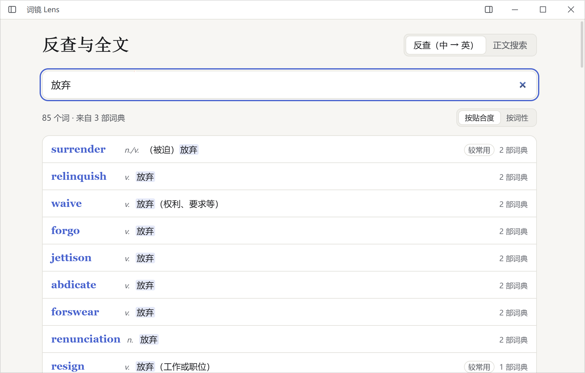
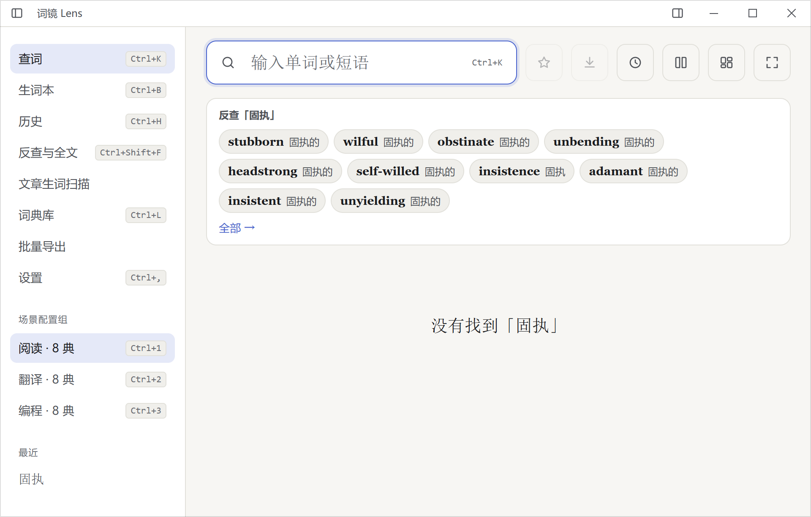
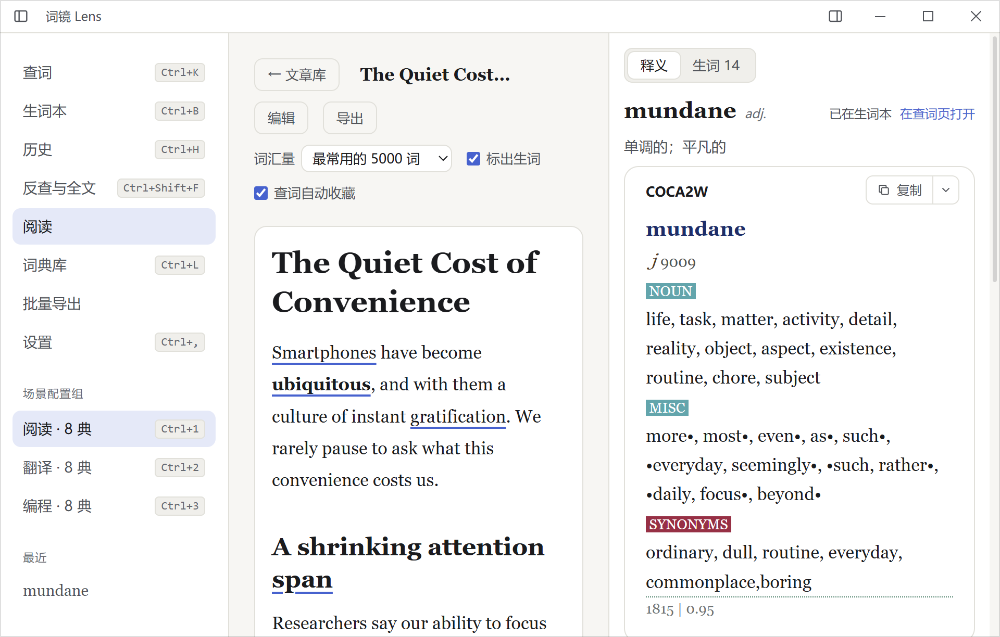
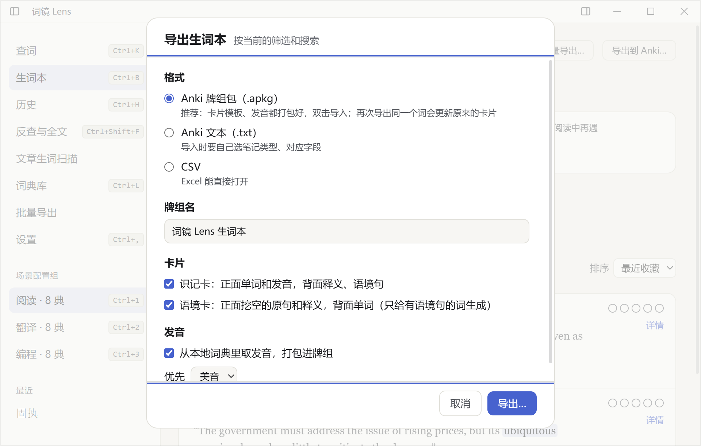

# 词镜 Lens

本地优先、键盘优先的 Windows 桌面查词软件：多部 MDict / StarDict 词典一起查，在任何程序里划词取句，生词带着原句进生词本，再导出到 Anki。

*A local-first, keyboard-first dictionary app for Windows. Look up words across your own MDict / StarDict dictionaries, capture words with their sentences from any app, and send them to Anki.*

> Lens 不附带任何词典。词典内容的版权归各词典所有，请使用你自己合法获得的词典文件。



## 功能

**查词**

- 支持 MDict（`.mdx` / `.mdd`，含加密索引）、StarDict（`.ifo`、`.dict.dz`、`.syn`）和 Lens JSON 词典，FST 索引 + 内存映射，十几部大词典也是即时出结果。
- 词典原样的 HTML / CSS 在隔离区里渲染，自动适配词典写给 `body` 的样式和自带字体；Speex 发音（`.spx`）自动转码播放。
- 屈折形式自动还原（went → go），拼写纠错，场景配置组（阅读 / 翻译 / 编程各用一套词典），可选在线词典（Free Dictionary、Merriam-Webster、Oxford）。

**划词与语境**

- 在任何程序里选中单词按快捷键，弹出查词小窗；自动抓取所在的句子（UI Automation，读不到时回退到剪贴板），收藏时连同原句和来源一起保存。
- 「当前语境」离线判断这个词在句中的词性和义项；「词汇网络」列出派生词、同根词、易混词、近义词（放射图或表格）。

**中文反查与正文搜索**（0.19）

- 给双解词典建全文索引后，输入中文找英文词：「放弃」→ surrender、abandon、relinquish、waive、forgo……按贴合度、收录词典数和常用度排序。
- 在所有词条的释义和例句里搜一段文字，中英文都行（take for granted、随处可见）。



**阅读**（0.20）

- 把英文文章存进 Lens：粘贴 Markdown，或打开、拖入 `.md` / `.txt` 文件，可以存很多篇，也可以直接编辑正文。
- 三栏：左边导航、中间文章、右边查词，两侧都能随时开关。点一个词（或拖选短语）就在右栏查，词典和顺序跟当前配置组；查过的词连同所在句子自动收进生词本，来源记成文章标题。
- 超过你词汇量的词按词频标在正文上（可关）；「生词」页列出全文生词，带词性、中文释义和认识率，可以批量收藏、标记认识。记住每篇读到哪里。
- 导出 PDF / HTML（0.21）：前面是标好生词、带编号的原文，后面是词汇表（单词、文中原句、词典释义）；书页、旁注、卡片三种版式。



**生词本、复习与导出**

- 生词本按原形合并，一个词可以有多条语境；FSRS 间隔重复复习。
- **Anki 牌组包（.apkg）**：自带笔记类型和两种卡片（识记卡、挖空语境卡），发音从本地词典取，双击导入；重复导出时更新原有笔记。也可以导出 Anki 文本或 CSV。
- 单词导出 PDF / HTML，批量导出词表；复制为 Markdown / HTML / 纯文本。
- 可选 AI 双语例句（Claude / DeepSeek，自带 API Key）。



**外观**

- 15 套内置主题（含铜版、构成、柔光等改版式主题），可导入自定义主题；沉浸模式、卡片墙。

## 安装

在 [Releases](https://github.com/jacknnnbauer/lens/releases) 下载 `Lens_x.y.z_x64-setup.exe` 安装。需要 Windows 10 1809 以上或 Windows 11（系统自带 WebView2）。安装包未做代码签名，第一次运行时 SmartScreen 会提示，选「仍要运行」。

数据全部保存在本机 `%APPDATA%\Lens`。会联网的只有在线词典、vocabulary.com 例句、AI 例句和检查更新，都可以在设置里关掉。

## 从源码构建

需要 Rust（stable）、Node.js 20+、pnpm，以及 Tauri 2 的 [Windows 依赖](https://v2.tauri.app/start/prerequisites/)。

```bash
pnpm install
pnpm tauri dev          # 开发运行
cargo test --manifest-path src-tauri/Cargo.toml
pnpm test               # 前端单元测试
pnpm tauri build        # 打包（NSIS 安装包）
```

- 架构与规格：[SPEC.md](SPEC.md)；开发约定：[CLAUDE.md](CLAUDE.md)。
- 内置数据由脚本生成：`scripts/build_wordnet.py`（WordNet 3.1）、`scripts/build_freq.py`（wordfreq 词频表）。
- 测试只用 `fixtures/` 里自制的小词典，仓库不收录任何商业词典。

## 第三方数据与代码

| 内容 | 来源 | 许可 |
|---|---|---|
| `src-tauri/data/wordnet.tsv.gz` | Princeton WordNet 3.1 | [WordNet License](src-tauri/data/WORDNET-LICENSE) |
| `src-tauri/data/wordfreq_en.txt.gz` | wordfreq 3.1（Robyn Speer） | [CC BY-SA 4.0](src-tauri/data/WORDFREQ-LICENSE) |
| `src-tauri/third_party/speex` | Xiph.Org libspeex | [BSD](src-tauri/third_party/speex/COPYING) |

## 许可证

代码按 [MIT](LICENSE) 许可发布。上表中的第三方数据和代码按各自的许可分发。
